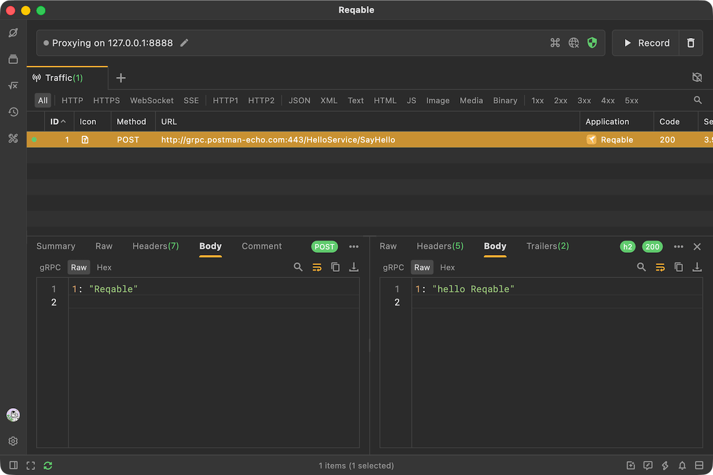
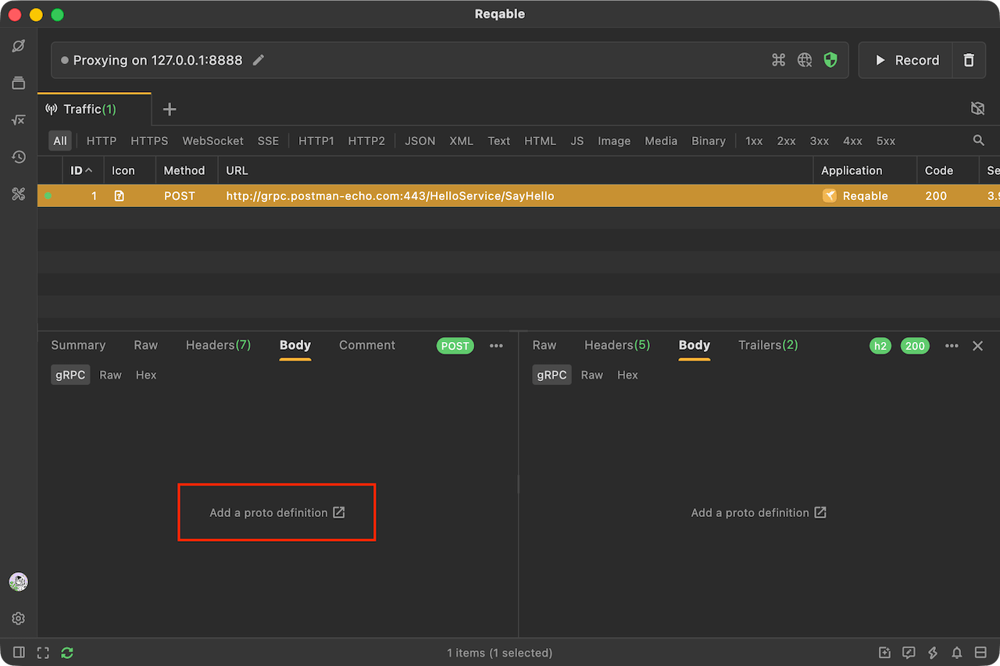
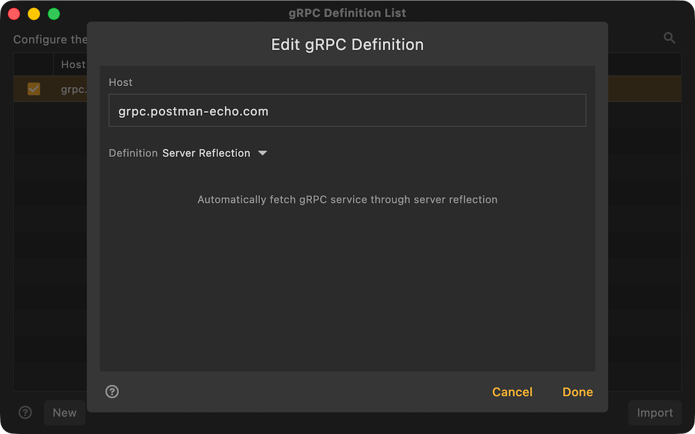
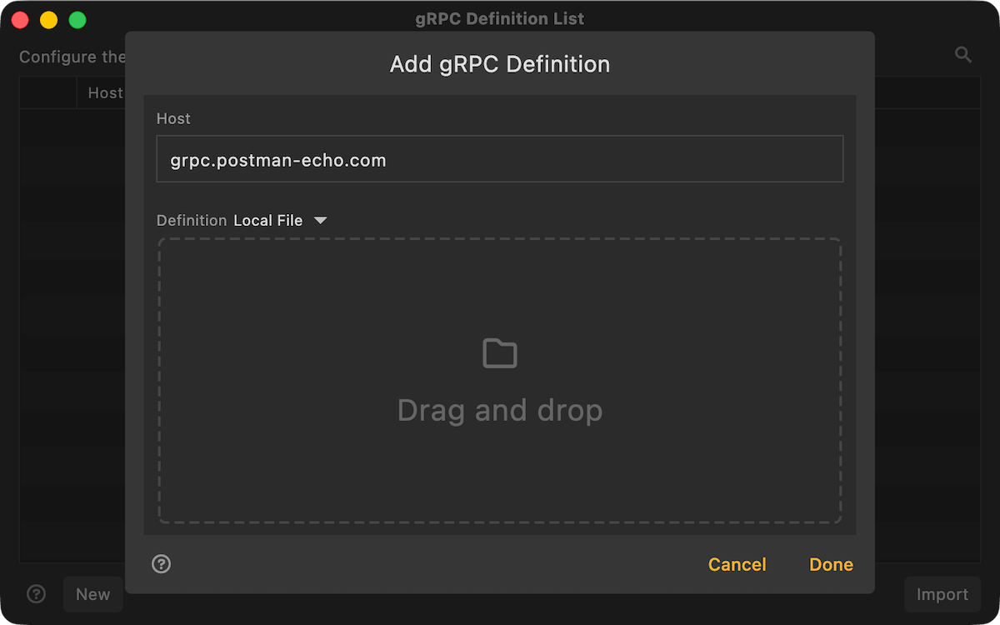
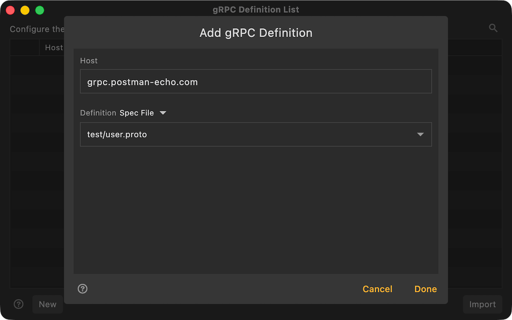
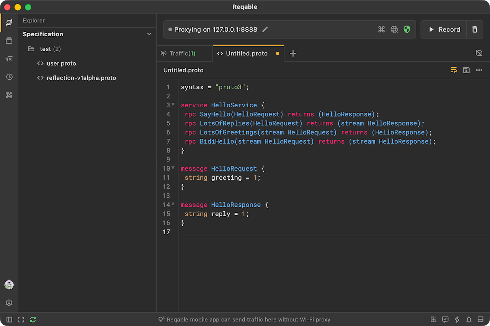
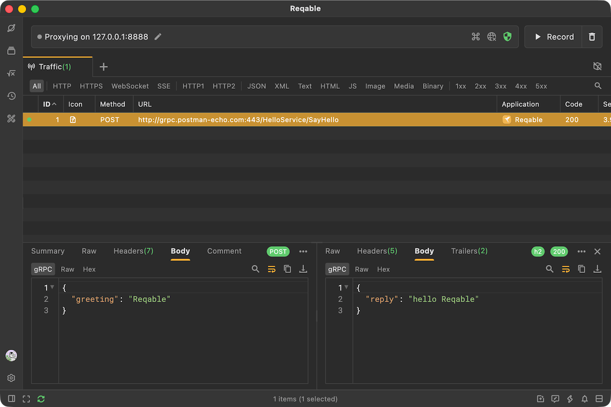

# gRPC Support

gRPC requests send and receive data in the [Protobuf](./protobuf) format. Without a Proto file, only incomplete data can be viewed under the `Raw` tab.

If you have a Proto file, you can configure it to view the complete data in JSON format. Click the `gRPC` tab to open the configuration page.

Alternatively, select `gRPC` from the `Tools` menu to open the configuration list.

Reqable matches gRPC Proto definitions by domain name. The domain name supports the `*` and `?` wildcards.

Proto definitions can be configured in the following three ways:

#### Server Reflection

If gRPC reflection is enabled on the server, Reqable can automatically retrieve the Proto definition from the server, so no manual Proto file configuration is required.

#### Local File

Import a Proto file from your device. If the definition depends on multiple Proto files, select the root Proto file.

#### Spec File (Recommended)

Spec files are Proto files managed by Reqable. Select an existing spec file from the drop-down list or create a new one. If the definition depends on multiple Proto files, select the root Proto file.

You can edit spec files in Reqable. If cloud data synchronization is enabled, you can also save them to the cloud and sync updates to other devices in real time.

After completing the Proto configuration, you can view the decoded gRPC messages.

