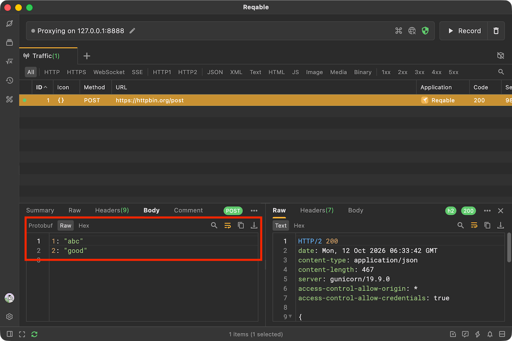
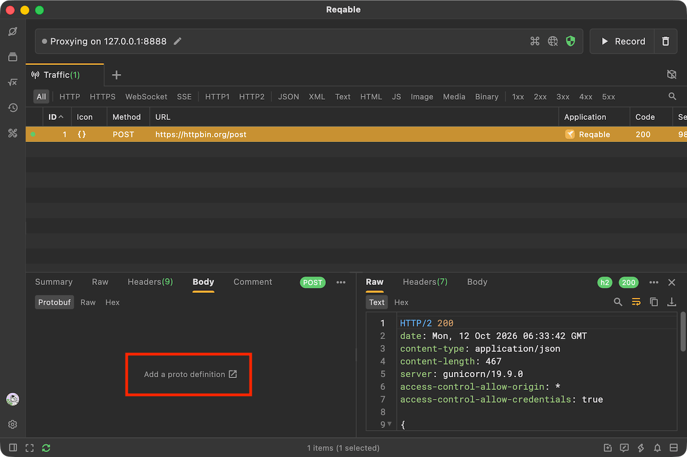
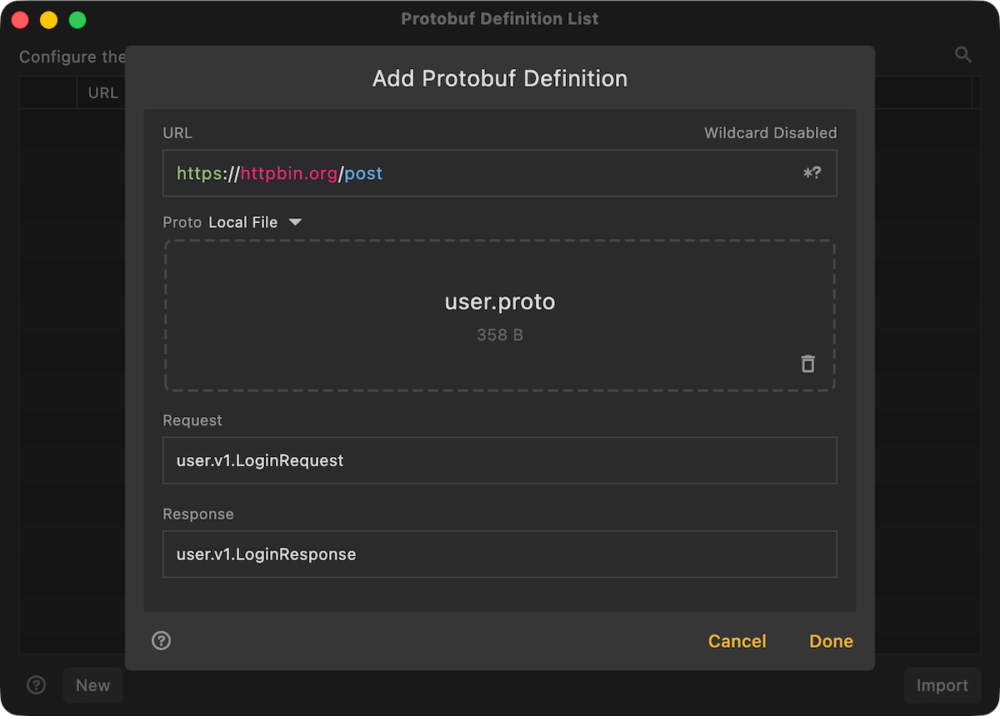
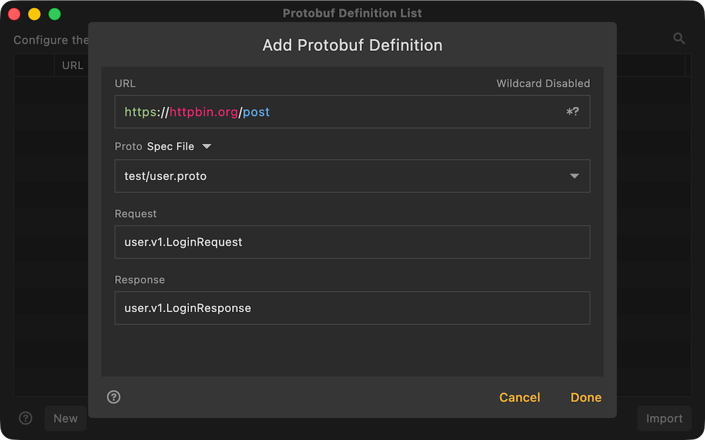
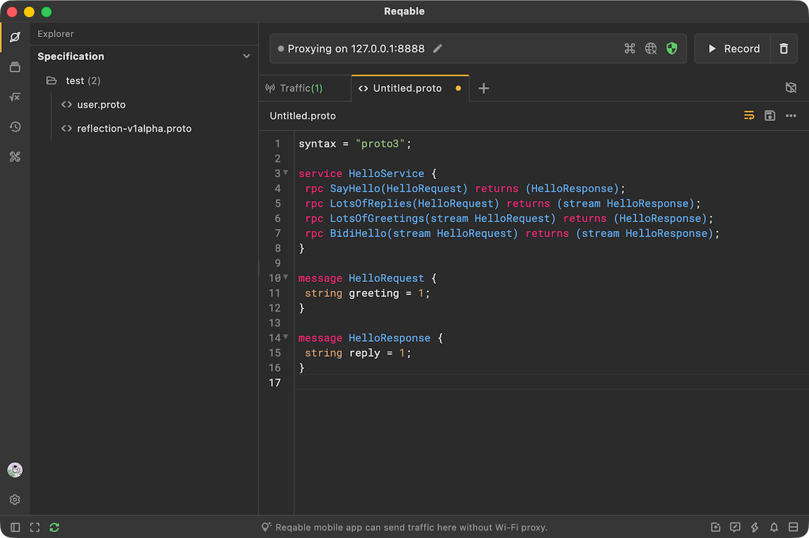
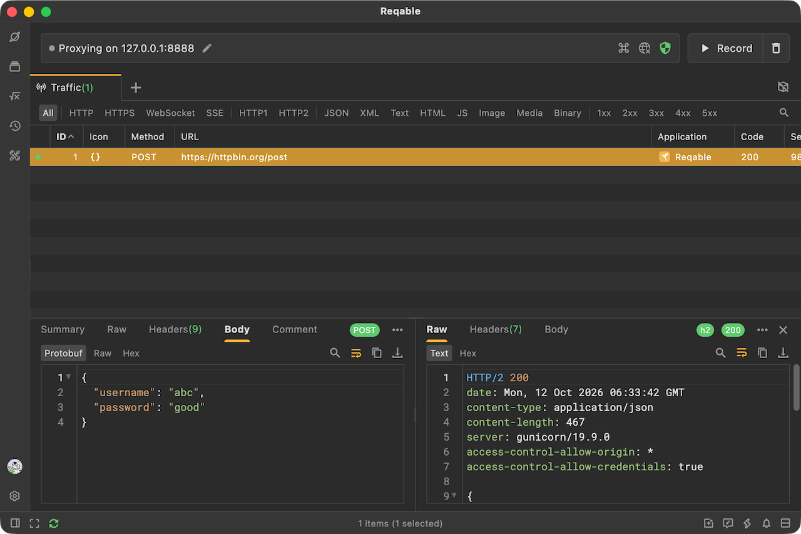

# Protobuf Support

Protobuf is a binary data format that produces smaller payloads than traditional JSON. Protobuf relies on Proto files for encoding and decoding. Without a Proto file, only incomplete data can be viewed under the `Raw` tab.

If you have a Proto file, you can configure it to view the complete data in JSON format. Click the `Protobuf` tab to open the configuration page.

Alternatively, select `Protobuf` from the `Tools` menu to open the configuration list.

Reqable associates a request with a Proto definition by its request URL. Enter the complete URL and use the `*` and `?` wildcards when necessary.

Proto definitions can be configured in the following two ways:

#### Local File

Import a Proto file from your device. If the definition depends on multiple Proto files, select the root Proto file.

#### Spec File (Recommended)

Spec files are Proto files managed by Reqable. Select an existing spec file from the drop-down list or create a new one. If the definition depends on multiple Proto files, select the root Proto file.

You can edit spec files in Reqable. If cloud data synchronization is enabled, you can also save them to the cloud and sync updates to other devices in real time.

At least one request or response message must be configured.

After completing the Proto configuration, you can view the decoded Protobuf messages.

