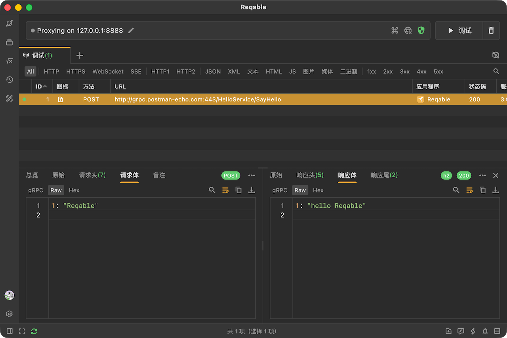
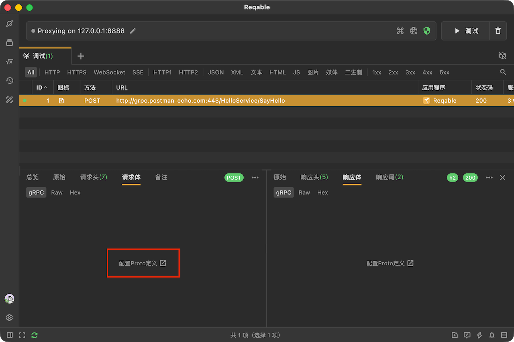
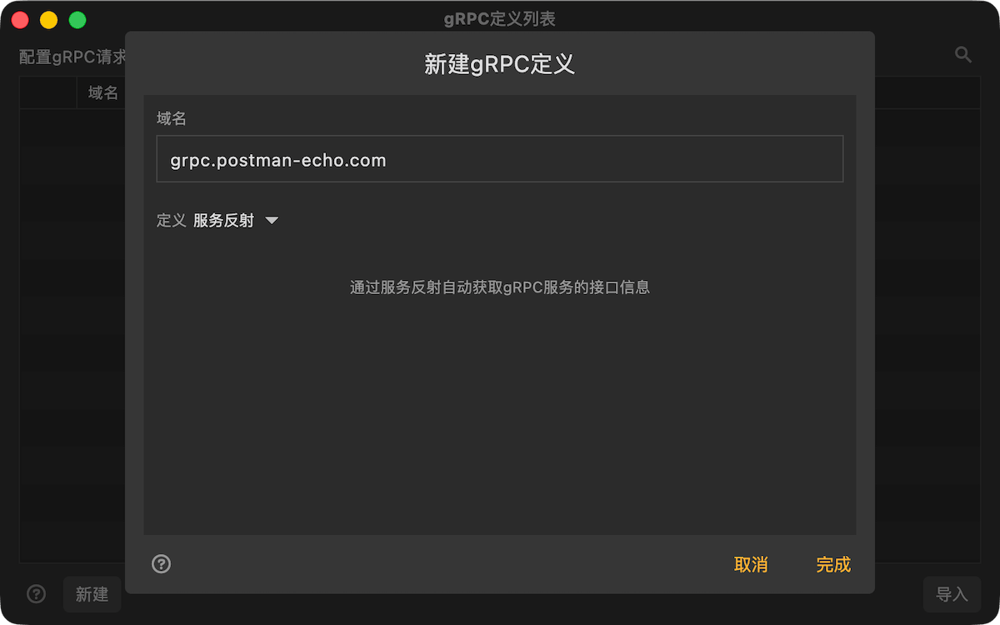
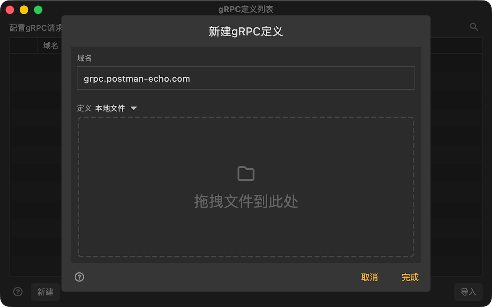
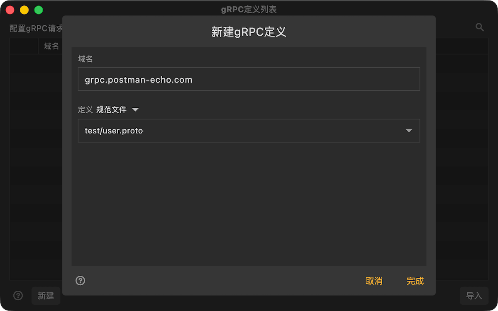
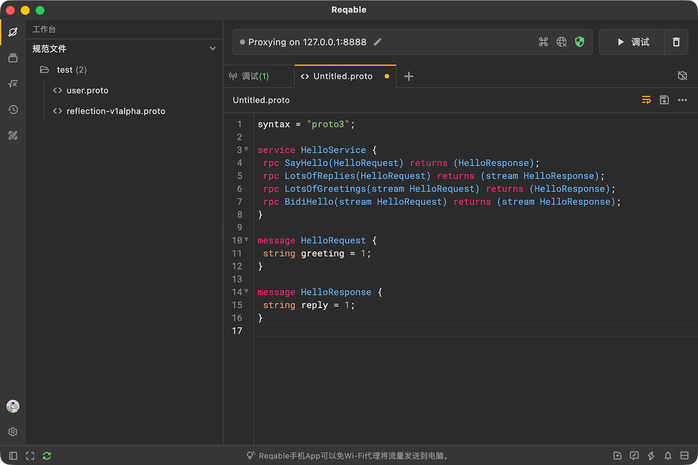
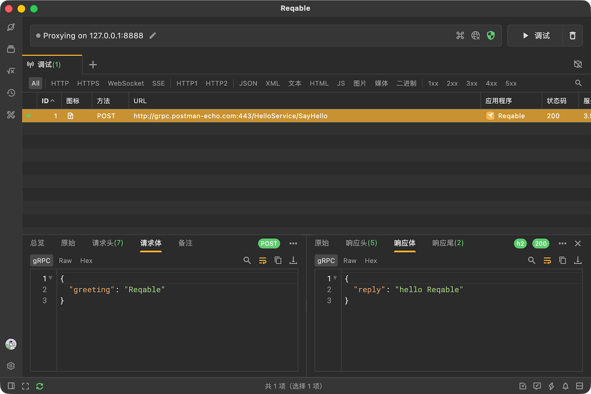

# gPRC

gRPC请求使用 [Protobuf](/protobuf) 格式传输和接收数据，没有Proto文件的情况下，可以在 `Raw` 标签下查看到不完整的数据。

如果有Proto文件，配置后便可以查看完整的数据（以JSON的形式显示），在 `gRPC` 标签下点击即可进入配置页面。

另外，还可以通过 `工具` 菜单中的 `gRPC` 选项进入配置列表。

gRPC的Proto定义需要使用域名进行匹配，域名支持通配符 `*` 和 `?`。

Proto支持下面三种定义方式：

#### 服务反射

如果服务器配置了gRPC反射功能，选用此方式后Reqable会自动从服务器拉取Proto定义信息，需要手动配置Proto文件。

#### 本地文件

导入设备本地Proto文件。如果有多个依赖的Proto文件，请选择根Proto文件。

#### 规范文件（推荐）

规范文件是指由Reqable管理的Proto文件，在下拉框中可以选择已有规范文件或者新建一个规范文件。如果有多个依赖的Proto文件，请选择根Proto文件。

规范文件可以在Reqable中进行编辑，如果启用了云端数据同步功能，还可以保存到服务器以及实时同步更新到其他设备。

Proto配置完成后，便可以查看到解析后的gRPC消息了。

